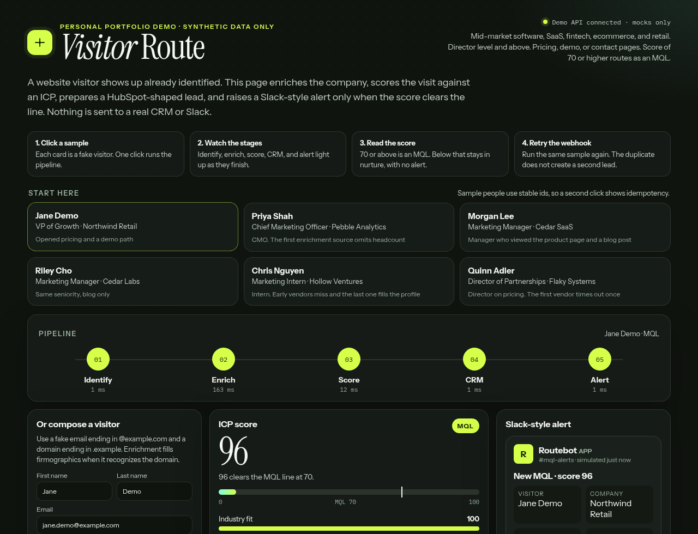
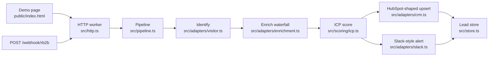
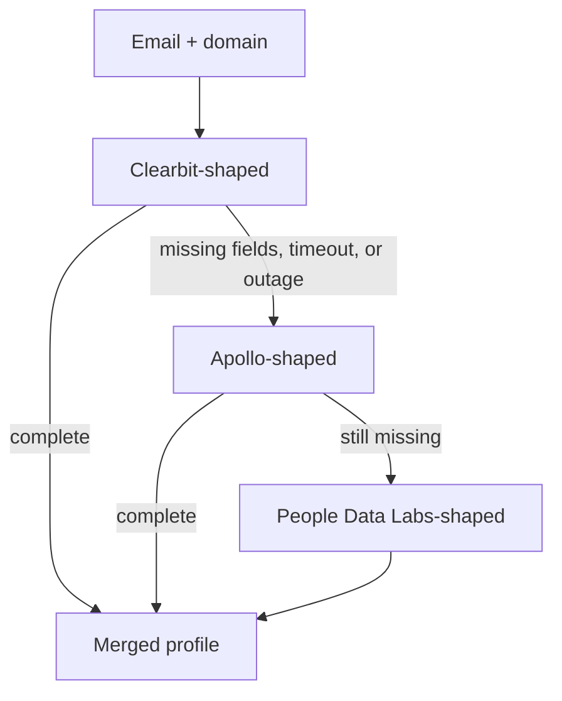

# Visitor ID → enrichment → ICP score → CRM lead

Live demo: visitor ID to enrichment to ICP score to CRM lead (fake data only).

**This is a personal portfolio demo using synthetic data.** Every person, company, domain, and page path in the app is fictional (`jane.demo@example.com`, `northwind-retail.example`, `acme-loyalty.example`). Nothing here is a customer, an employer, a CRM export, or a production metric.

Open the page, click a sample visitor, and watch five stages light up: **Identify → Enrich → Score → CRM → Alert**. A score of 70 or higher becomes an MQL and raises a Slack-style card. The same webhook, sent again, does not create a second lead or a second alert.



The number on that screen is the demo model scoring a fictional person. It is not a campaign result. A short walkthrough video will be added.

## Results — placeholder, not a measurement

These cells are layout only. They are **not** measured outcomes from a live program, a past employer, or this repository. Do not cite them as performance.

| Signal | Value |
| --- | --- |
| Visitors processed | PLACEHOLDER — not a measured result |
| MQL rate | PLACEHOLDER — not a measured result |
| Time from identify to CRM | PLACEHOLDER — not a measured result |
| Duplicate alerts on retry | PLACEHOLDER — not a measured result |
| Pipeline sourced revenue | PLACEHOLDER — not a measured result |

What the code *does* guarantee, and what the tests check, is behavior: one lead per idempotency key, one alert per qualified lead, and a score you can recompute from the weights in `src/scoring/config.ts`. That is a product property, not a case-study result.

## The problem

Marketing sites get visitors that sales never sees in time. A tool in the shape of RB2B can put a name on an anonymous session, but the name alone is not a lead. Someone still has to attach company facts, decide whether the account fits, write it to the CRM once, and ping the channel that actually responds.

Done by hand, that work shows up late, misses the buying committee, and double-posts when the webhook retries. This demo is that handoff, small enough to run in a browser and explicit enough to read without opening the TypeScript.

## What the page does

1. **Identify.** A form or a sample visitor becomes an RB2B-shaped payload (`Business Email`, `Captured URL`, `Seen At`, and the same fields in snake_case). The worker normalizes it.
2. **Enrich.** A Clay-style waterfall asks three fake vendors in order: a Clearbit-shaped source, an Apollo-shaped source, then a People Data Labs-shaped source. If the first one times out or omits headcount, the next one fills the gap. If all three miss, scoring continues with what the webhook already had.
3. **Score.** A pure function scores industry fit, title seniority, company size, and page intent. The default line is **70**. At or above that line the visit is an **MQL**. Below it, the visit stays in **nurture**.
4. **CRM.** The worker builds the HubSpot CRM v3 contact and company batch-upsert bodies, plus a v4 association. The mock records those bodies and invents `demo_contact_…` ids. It does not call HubSpot.
5. **Alert.** MQLs get a Slack incoming-webhook payload and a card in the page. Nurture visits skip the alert on purpose. The webhook stub is unused unless you opt in.

The right-hand column, and the payload panel under the pipeline, show the JSON at each step so a reader can see the contract without trusting a paragraph.

## Architecture





| Box | What it is responsible for | Where it lives |
| --- | --- | --- |
| Demo page | Samples, form, stage animation, score bars, JSON, feed, Slack card | `public/index.html` |
| HTTP | `POST /webhook/rb2b`, `POST /api/demo/run`, `GET /api/leads` | `src/http.ts`, `src/index.ts` |
| Pipeline | Stage order, timings, logs, idempotency | `src/pipeline.ts`, `src/idempotency.ts` |
| Identify | RB2B field aliases and the synthetic-data guard | `src/adapters/visitor.ts` |
| Enrich | Waterfall, retries, vendor-shaped raw payloads | `src/adapters/enrichment.ts`, `src/adapters/live-enrichment.ts` |
| Score | Weights, threshold, reasons | `src/scoring/icp.ts`, `src/scoring/config.ts` |
| CRM | HubSpot v3 / v4 request builders and the live stub | `src/adapters/crm.ts` |
| Alert | Slack block payload and the unused webhook stub | `src/adapters/slack.ts` |
| Store | Memory, optional KV, in-flight dedupe | `src/store.ts` |
| Contracts | JSON Schema for the payloads above | `schemas/` |
| Seed | 20 fictional visitors, 6 of them on the page | `src/data/visitors.ts` |

Retries use exponential backoff inside the enrich step (`src/retry.ts`). Logs are JSON lines with `event`, `stage`, `attempt`, and `durationMs` (`src/logger.ts`). A retried webhook resolves to an idempotency key from an `Idempotency-Key` header, or else a hash of email, domain, captured URL, seen-at time, and pages. The second delivery returns the original lead and does not call CRM or Slack again. Two deliveries in flight share one run.

## How the score is configured

This is the model, not a result. Change it in `src/scoring/config.ts`.

| Input | Default weight | What scores high |
| --- | --- | --- |
| Industry fit | 30% | Software, SaaS, fintech, ecommerce, retail |
| Title seniority | 25% | Director, VP, head of, and executive titles |
| Company size | 20% | Mid-market headcount, roughly 50 to 1,000 |
| Page intent | 25% | Pricing, demo, contact, and signup paths |

The MQL line defaults to **70**. `ICP_THRESHOLD` overrides it without a code change. A visitor can clear the line on fit and seniority even with a light page trail, and an intern on the blog does not. The bars on the page are the four raw scores. The big number is the weighted total.

## Run it locally

Node 20 or newer.

```bash
npm install
npm run dev
```

Open [http://127.0.0.1:8787](http://127.0.0.1:8787). Click **Jane Demo** or any other card under **Start here**. Then click the same card again and read the duplicate banner.

```bash
npm test
npm run typecheck
npm run replay
```

`npm run replay` pushes the 20 seeded visitors through the pipeline in-process, prints the seed scores, and pushes them a second time to prove retries collapse. The printed scores are the fake seed, labeled as such in the script output. They are not the Results table above.

With the dev server already running:

```bash
npm run replay:remote
```

That posts the same seed to `POST /webhook/rb2b`.

## Deploy

The worker is Cloudflare Workers via Wrangler. No account is required for `npm run dev`.

```bash
npx wrangler login
npx wrangler deploy
```

`wrangler.toml` ships `ADAPTERS=mock`. Leads live in memory on the isolate (the last 500). To keep them across isolates, create a namespace and uncomment the binding:

```bash
npx wrangler kv namespace create LEADS_KV
```

Paste the id into the commented `kv_namespaces` block. Do not put tokens in `wrangler.toml`. Secrets belong in `.dev.vars` locally or `wrangler secret put` for a real deploy. Copy `.env.example` and leave the secret lines blank.

The public route rejects any email that does not end in `@example.com` and any domain that does not end in `.example`. That guard is intentional. Do not point a real visitor webhook at this demo.

## Swap the mocks for the live stubs

Set `ADAPTERS=live` and provide only the tokens you mean to use. Missing tokens fall back to the mock and a structured warning. The request builders are the same functions the mock uses, so the JSON you already saw on the page is the body that would be sent.

| Step | Mock | Live stub | Environment variable |
| --- | --- | --- | --- |
| Enrichment | `src/adapters/enrichment.ts` | `executeClearbit`, `executeApollo`, `executePdl` in `src/adapters/live-enrichment.ts` | `CLEARBIT_KEY`, `APOLLO_API_KEY`, `PDL_API_KEY` |
| CRM | HubSpot-shaped bodies, no network | `executeHubSpotUpsert` in `src/adapters/crm.ts` | `HUBSPOT_TOKEN` |
| Alert | Card in the page | `postSlackWebhook` in `src/adapters/slack.ts` | `SLACK_WEBHOOK_URL` |

Live calls:

- `GET https://person.clearbit.com/v2/combined/find?email=`
- `POST https://api.apollo.io/api/v1/people/match`
- `GET https://api.peopledatalabs.com/v5/person/enrich?email=`
- `POST https://api.hubapi.com/crm/v3/objects/contacts/batch/upsert`
- `POST https://api.hubapi.com/crm/v3/objects/companies/batch/upsert`
- `PUT https://api.hubapi.com/crm/v4/objects/contacts/{id}/associations/default/companies/{id}`
- `POST` to the Slack incoming webhook URL you supply

HubSpot's `industry` property is an enum. The builder maps known ICP industries (for example Retail → `RETAIL`) and omits the field when it has no mapping. `icp_score` and `icp_disposition` are custom contact properties. Create those two single-line text properties before a live upsert, or the call will 400.

The recorded request specs store `Bearer $HUBSPOT_TOKEN` and the Slack placeholder URL. A token you set at runtime is sent on the wire and is not copied onto the lead.

## Tests

GitHub Actions (`.github/workflows/ci.yml`) runs `npm run typecheck`, `npm test`, and `npm run replay` on Node 22.

Vitest covers the score math, waterfall fallback, flaky-vendor retry, idempotency (including two in-flight webhooks), KV rehydration, the HTTP routes, the SSE demo stream, JSON Schema, and the live stubs against a fake `fetch`. A source scan fails the build if a non-example email or a real-looking token shows up.

## Repository topic

This repo should carry the GitHub topic `marketing-portfolio`. Topics are a repository setting, not a file, so this checkout cannot apply them by itself. The topic is also recorded in `package.json` keywords and `.github/repository-metadata.json`.

```bash
gh repo edit growth-by-krishi/rb2b-clay-hubspot-pipeline --add-topic marketing-portfolio
```

## Privacy

Personal portfolio demo. Synthetic data only. No real names, inboxes, employers, customer lists, phone numbers, or production metrics belong in this repository. `.env.example` documents empty secret names. `.dev.vars` and `.env` are gitignored.
